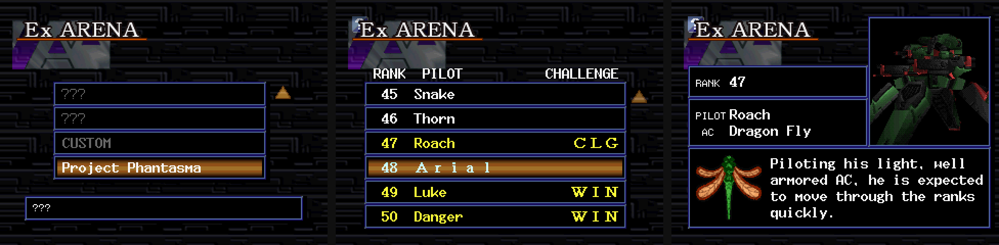
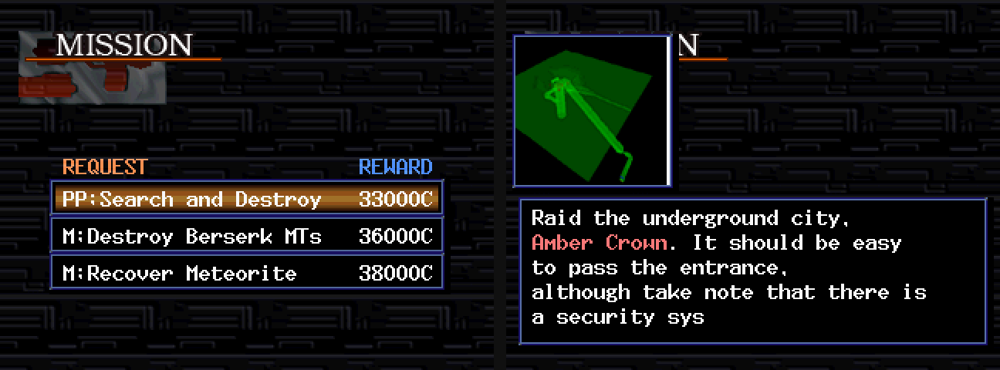

# Armored Core: Master of Arena — PC (unofficial build)

A native PC version of **Armored Core: Master of Arena** (PS1), with a
controller-first launcher, online/LAN versus, an AI battle mode and content
from **Armored Core: Project Phantasma** added into the game.

Built on the **[AC1Recomp](https://github.com/NeonLightning/AC1Recomp)**
static recompilation by NeonLightning. This fork focuses on Master of Arena
only.

**No game data is included.** You need your own copy of the game.

**[Download the latest release](https://github.com/Hatdagger/AC1Recomp/releases)**
(Windows `.zip`, Linux / Steam Deck `.AppImage`)

---

## 1. Put your disc next to the game

- **Required:** *Armored Core: Master of Arena* (USA) **Disc 1** as `.cue` + `.bin`.
- Put the disc image in the **same folder** as `Armored Core Moa.exe` (or the
  AppImage). It is found automatically, so there's nothing to select.
- **Optional:** *Armored Core: Project Phantasma* (USA), in the same folder,
  adds the Phantasma arena and missions (see below).

### One disc for everything

You only need Disc 1. Everything that normally needs Disc 2 (Ex Arena,
Ranker MK and so on) plays straight from Disc 1, with no disc swapping.

The game still shows its old **DISC CHANGE** icon and may still say
*"Insert DISC 2"*. **Ignore it:** press X and carry on. All the content is
there.

---

## 2. Launcher

A launcher in Master of Arena's own style, made for a **gamepad**
(Steam Deck and handheld PCs included). No mouse needed.

- **Start:** launch the game.
- **Multiplayer:** two-player versus over your network (**LAN**) or straight
  to an address (**direct IP**).
  - One player hosts a room, the other joins (recent hosts are remembered, and
    an IP address is entered digit by digit with the d-pad).
  - **Names are picked for you** from the game's arena pilot names, so
    there's nothing to type.
  - Each player plays on their own screen, with their own AC and memory card.
- **Extra Garage:** build your AC in 3D, manage AI cards and memory card
  saves, and set up AI matches (see below).
- **Mods:** switch features on and off, or install new ones.
- **Extras:** *Install data from Project Phantasma* builds the Phantasma
  content on your PC from your own disc (it finds the disc by itself).
  *Reinstall additional content* removes it and builds it again.
  *Install 3D AC models (optional)* reads the AC models from your Master of
  Arena disc (about 20 MB, kept in the `acmodels` folder) for Assembly.
- **Updates:** checks GitHub for a new release and installs it, only when you
  ask.

---

## 3. Extra Garage

Launcher → **Extra Garage**: a garage outside the game around one shared AC,
the **garage AC**, which is kept between launches.

- **Assembly (preview):** build the garage AC and see it in 3D. Install the
  models once first: **Extras** → *Install 3D AC models (optional)*. Turn
  the AC with the right stick (or Q/E and R/F). **Triangle / Y** shows a
  part's full figures; in a part list, **Square / X** marks up to three parts
  to compare (green better, red worse than the fitted part). The build checks
  the game's own rules and says if the game won't field the AC.
- **Option Parts:** the garage AC's optional parts on their own screen, with
  the slots each takes and what it does.
- **AI Card Management:** your AI cards: edit their AI, rename, delete, and
  change their AC.
- **Data:** a memory card manager. Load an AC from a save into the garage,
  save the garage AC or an AI card to the card as a **new** save, export
  saves as AI cards, and delete saves. **L1 / R1** switch between the `.mcd`
  files in the Memory Card folder, **Square / X** marks several saves,
  **Triangle / Y** shows a save's parts. Only Master of Arena saves can be
  changed; nothing is overwritten and every change keeps a `.bak` copy.
- **AI Arena Setup:** *Player vs AI* (you fly unit 1: the garage AC or an AI
  card's AC) or *AI vs AI* (two AI cards). Pick the map and time limit (2:00,
  5:00 or no limit).

---

## 4. AI cards

AI matches fly ACs with the game's own arena AI.

- **Where:** Launcher → **Extra Garage** → **AI Arena Setup**.
- **The ACs are "cards":** each one is a square picture, like an AC emblem,
  with the whole build (parts, optional parts, colours, Human PLUS, emblem)
  stored in a colour strip down its left edge. They're easy to share as
  ordinary images.
- **Make cards** with the
  **[Raven Card Builder](https://hatdagger.github.io/ACMOA-AI-CARDBUILDER/)**,
  a page that runs in any web browser. Pick parts from sorted lists, check the
  stats and the game's own build rules, and turn any picture into the emblem.
- **Or export your own ACs:** **Extra Garage** → **Data** turns memory card
  saves into cards.
- Put cards in the **Memory Card** folder and they show up in the garage.

---

## 5. Project Phantasma arena

- **How to get it:** Launcher → **Extras** → *Install data from Project
  Phantasma*. If you installed it with a version before 0.4.1, use
  *Reinstall additional content* to get the missions too.
- **Where it is:** in game, **Ex Arena** → **Project Phantasma** (the tenth
  entry).
- **What came over:** all **49 arena ACs from Project Phantasma**, with their
  pilots, AC names, emblems, portraits and profiles.
- It has its own ranking: you start at the bottom (rank 50) and climb.
  Prize money is scaled to Master of Arena's economy.

---

## 6. Project Phantasma missions (work in progress)

**The goal:** play all 17 Project Phantasma missions inside Master of Arena,
with their own briefings, maps and enemies, and with any AC you build.

**Where it is today (0.8.3):**

- Installed together with the arena (same Extras button).
- In game, **Missions** opens a short list first: *Armored Core* (not
  installed yet), *Project Phantasma* and *Master of Arena*. Pick one to see
  its missions.
- While the missions are being tested, the Phantasma list shows all of them
  that work. Playing them no longer moves Master of Arena's own story forward.
- **12 of 17 missions are in.** Missions 1, 7, 9, 11 and 14 are left out for
  now because they freeze or don't display correctly.
- Progress is saved in `Phantasma Missions.txt` in the **Memory Card** folder,
  one progress per memory card (every save on the card shares it).
- A few long mission names are shortened to fit the list.

**Planned:** the missing missions, and replays after the last mission.

---

## Folders (Windows release)

| Folder / file | What it is |
|---|---|
| `Armored Core Moa.exe` | Start here |
| your `.cue` + `.bin` | Your Master of Arena Disc 1 (and optionally Project Phantasma) |
| `Memory Card/` | Memory cards, AI cards (`.png`) and Phantasma mission progress |
| `Mods/` | Mods |
| `acmodels/` | 3D AC models for Assembly (only after the optional install) |
| `garage/` | The garage AC (Extra Garage) |
| `RecompData/` | Everything else the game needs |

---

## Credits

- **[AC1Recomp](https://github.com/NeonLightning/AC1Recomp)** by NeonLightning,
  the recompilation this build is based on.
- Armored Core is © FromSoftware. This is an unofficial fan project, with no
  game data included and not affiliated with FromSoftware or Agetec.

Problems or feedback: please open an
[issue](https://github.com/Hatdagger/AC1Recomp/issues) and say what you did,
what you saw, and whether you're on Windows or Linux / Steam Deck.
