

  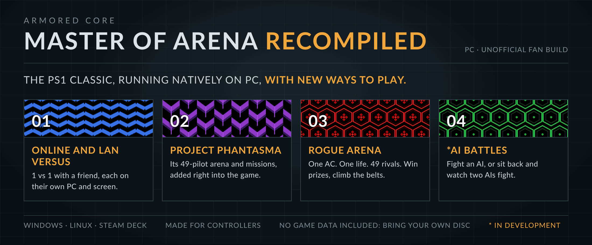

<h3 align="center">
  <a href="https://github.com/Hatdagger/AC1Recomp/releases">⬇&nbsp; DOWNLOAD &nbsp;·&nbsp; Windows · Linux · Steam Deck</a>
</h3>

  <b>No game data included.</b> You need your own <b>Armored Core: Master of Arena</b> disc (USA, Disc 1).

  <a href="#install">Install</a> ·
  <a href="#online-and-lan-versus">Online and LAN versus</a> ·
  <a href="#direct-ip-guide">Direct IP guide</a> ·
  <a href="#project-phantasma">Project Phantasma</a> ·
  <a href="#rogue-arena">Rogue Arena</a> ·
  <a href="#ai-battles">AI Battles</a> ·
  <a href="#extra-garage">Extra Garage</a> ·
  <a href="#the-launcher">Launcher</a> ·
  <a href="#credits-and-licenses">Credits</a>

---

## Install

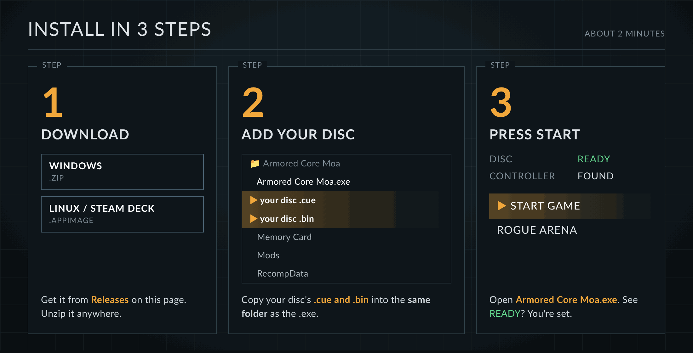

1. **Download** from [Releases](https://github.com/Hatdagger/AC1Recomp/releases). Unzip it.
2. **Copy your disc** (`.cue` + `.bin`) into the folder, next to `Armored Core Moa.exe`.
3. **Start** `Armored Core Moa.exe`. See **DISC: READY**? You're set.

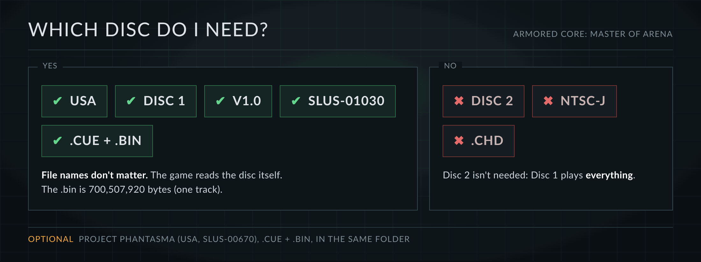

> [!TIP]
> Want the 3D garage and the Project Phantasma content? In the launcher, open
> **Extras** and run both installs once.

<b>Linux / Steam Deck</b> (click to open)

1. Download the `.AppImage` from [Releases](https://github.com/Hatdagger/AC1Recomp/releases).
2. Put it in a folder of its own (for example `~/Games/ACMoA`) with your disc
   `.cue` + `.bin` **next to it**.
3. Right-click it → Properties → Permissions → tick **Is executable**.
4. Double-click to start. On Steam Deck: in Desktop Mode, **Add to Steam**,
   then play it from Game Mode.

Your memory cards are kept in `~/.local/share/armored-core-moa/Memory Card`
and carry over to every new version.

<b>More install help</b>: old saves, updating, the Disc 2 message (click to open)

**The disc, in detail**

| | Needed | Optional |
|---|---|---|
| Game | Armored Core: **Master of Arena** | Armored Core: **Project Phantasma** |
| Region | **USA** | USA |
| Disc | **Disc 1** | its one disc |
| Version | **v1.0** | — |
| Serial | **SLUS-01030** | SLUS-00670 |
| Format | **`.cue` + `.bin`** (one track) | `.cue` + `.bin` |

- The `.bin` should be **700,507,920 bytes** (CRC32 `446ae06c`), a standard
  one-track rip such as a Redump dump.
- File names don't matter. The game reads the disc itself.
- The disc can also go in a subfolder named `disc`, `discs`, `iso`, `roms` or
  `games`. Keep Project Phantasma in the same folder as Master of Arena.
- Other formats like `.chd` may start the game, but Rogue Arena, Extras and
  Multiplayer need `.cue` + `.bin`.
- Japanese (**NTSC-J**) discs are not supported.

**Old saves:** copy a 128 KB PS1 memory card file (`.mcd` / `.mcr` from an
emulator) into `Memory Card` and name it `card1.mcd`. Back up the one already
there first.

**Updating:** Launcher → **Updates** → *Check for update*, then *Download and
apply update*. Your saves, mods and disc stay put.

**"Insert DISC 2"?** You only need Disc 1: it plays everything, Ex Arena
included. If the game shows its old DISC CHANGE icon or asks for Disc 2,
just press X and carry on.

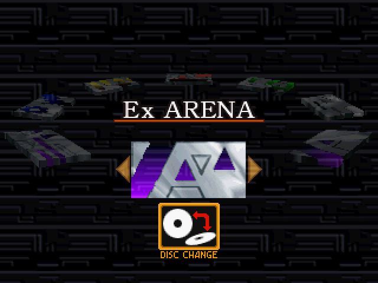

**Where things go (Windows)**

| Folder / file | What it is |
|---|---|
| `Armored Core Moa.exe` | Start here |
| your `.cue` + `.bin` | Your disc |
| `Memory Card/` | Memory cards (`card1.mcd`), AI cards, Phantasma mission progress, Rogue Arena runs and ghosts |
| `Mods/` | Mods (drop new ones in `Mods/new`, then install from **Mods**) |
| `Music/Rogue Arena/` | Your own Rogue Arena music (optional) |
| `RecompData/` | The game's own files. Leave it alone |

The whole folder can be copied to another PC as it is.

---

## Online and LAN versus

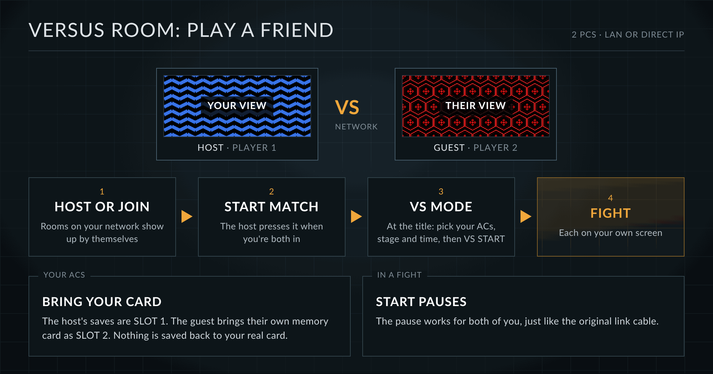

**1 vs 1, each on your own PC and screen.** On the same home network (LAN), or
over the internet with a direct IP.

**How to play:**

1. Launcher → **Multiplayer** → **LAN / Direct IP**. One of you picks **Host a
   room**, the other joins it.
2. When you're both in, the host presses **START MATCH**.
3. The game opens on both PCs. At the title, pick **VS Mode**, load an AC for
   each player, pick the stage and time, then **VS START**.

- **Same home network?** The room shows up by itself. Just pick it.
- **Over the internet?** Follow the [Direct IP guide](#direct-ip-guide) below.
- **Both of you need the same version and the same disc.**

<b>All the details</b> (click to open)

**Joining:** rooms on your network show up by themselves. For anyone else,
use *Join by address* (see the [Direct IP guide](#direct-ip-guide)). Recent
hosts are remembered. The host is player 1, the guest player 2.

**Callsign:** the name others see. Pick one from the arena roster (left /
right) or type your own.

**Memory cards:** in VS Mode, **SLOT 1** is the host's saves and **SLOT 2** is
the guest's. The guest brings their own memory card when **BRING MY MEMORY
CARD** is on (the host can allow or block it with **GUEST MEMORY CARD**).
Otherwise slot 2 is the host's second card. Each match plays on copies:
nothing is written back to anyone's real card.

**In a fight:** START pauses for both of you, as on the original link cable.

**Good to know:**
- Sound is mono during a match: each player hears their own side.
- The guest's own view needs the OpenGL renderer.

Offline, the game's own **VS Mode** is still split-screen on one PC with two
controllers.

### Direct IP guide

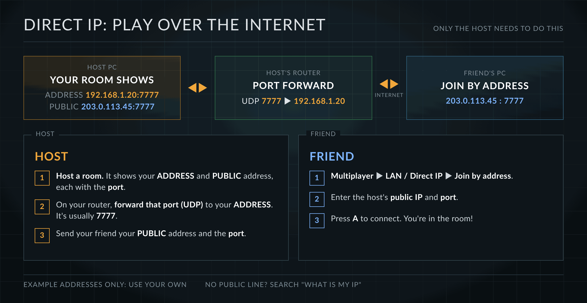

Playing someone who isn't on your home network? **Only the host needs to set
anything up.**

**Host:**

1. Launcher → **Multiplayer** → **LAN / Direct IP** → **Host a room**.
2. The room's **ROOM** panel shows two lines:
   - **ADDRESS**, like `192.168.1.20:7777`: your PC on your home network.
   - **PUBLIC**, like `203.0.113.45:7777`: your home on the internet.

   The number after the `:` is the **port** (usually **7777**).
3. On your router, **forward that port** (protocol **UDP**) to your
   **ADDRESS**. (How: see *Port forwarding help* below.)
4. Send your friend your **PUBLIC** address and the **port**.

**Friend:**

1. Launcher → **Multiplayer** → **LAN / Direct IP** → **Join by address**.
2. Enter the host's **public IP** and **port**. Use the d-pad (left / right
   picks a digit, up / down changes it, LB / RB jumps to the next number), or
   press **X** to type it.
3. Press **A** to connect. You're in the room!

> [!IMPORTANT]
> Never share your public IP in public places. Only send it to the friend
> you're playing with. **Streaming or taking screenshots?** The room screen
> shows your addresses, so keep it off stream.

<b>Port forwarding help</b> (click to open)

**On the router:**

1. Open your router's page in a web browser. It's often
   `http://192.168.0.1` or `http://192.168.1.1`, and is usually printed on a
   sticker on the router. Some routers use a phone app instead.
2. Sign in, then find **Port Forwarding**. It may be called *Virtual Server*,
   *NAT*, *Applications* or *Gaming*.
3. Add a rule:

   | Setting | What to enter |
   |---|---|
   | Protocol | **UDP** (or *Both*) |
   | External port | the room's port, usually **7777** |
   | Internal port | the same port |
   | Device / internal IP | the **ADDRESS** from the room screen, without the port, like `192.168.1.20` |

4. Save. Some routers need a restart.

**If it doesn't connect:**

- **Windows asked about the firewall?** Choose **Allow**. If you missed it,
  allow `ArmoredCoreMasterOfArena.exe` in *Windows Security → Firewall →
  Allow an app through firewall*.
- **The port in the room isn't 7777?** Forward the number the room shows
  instead.
- **No PUBLIC line in the room?** The lookup failed. Search "what is my IP"
  in a web browser instead.
- **Your ADDRESS changed?** Routers can hand out a new one after a
  restart. Set a *reserved* (or *static*) address for your PC in the router
  so the rule keeps working.
- **Still nothing?** Some internet providers (mobile, 4G/5G home internet and
  some fibre) don't allow port forwarding at all. If you can, swap roles and
  let your friend host.

---

## Project Phantasma

**Project Phantasma's arena and missions, added into Master of Arena.**

**How to get it:** put your Project Phantasma disc (USA, `.cue` + `.bin`)
next to your Master of Arena disc. Then Launcher → **Extras** → *Install
data from Project Phantasma*.

- **Arena:** in game, **Ex Arena** → **Project Phantasma**. All 49 pilots,
  with their own ranking. Start at 50 and climb.
- **Missions:** in game, **Missions** → **Project Phantasma**.
- Its pilots also show up in Rogue Arena.

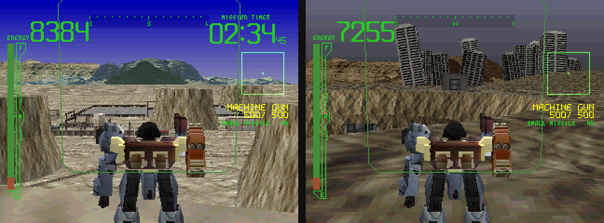

<b>More about the missions</b> (work in progress, click to open)

- **Missions** first asks which list to open: *Armored Core* (not added
  yet), *Project Phantasma* or *Master of Arena*.
- Phantasma missions don't move Master of Arena's own story forward.
- Progress is saved in `Phantasma Missions.txt` in the **Memory Card**
  folder.
- **Still being fixed:** missions 1, 7, 9, 11 and 14 may freeze or not work
  right yet.
- Installed before version 0.4.1? Use *Reinstall additional content* to get
  the missions.
- Arena prize money is scaled to Master of Arena's economy.

---

## Rogue Arena

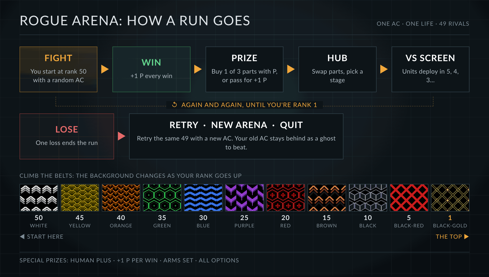

**One AC. One life. 49 rivals.** Start at rank 50, win, grab prizes, climb to rank 1.

**How to play:** Launcher → **Rogue Arena** → type a pilot name → **New Run**.

- Every win pays **1 P**. Spend it on prizes between fights.
- Lose once and the run is over. **Retry** to face the same 49 with a new AC.
- Your old AC stays in the arena as a **ghost**. Beat your past self!

<b>All the details</b> (click to open)

- **The start:** a random legal AC (always with a real main gun) and 0 P.
- **The rivals:** 49 ACs from every arena (Master of Arena's arena, the Ex
  Arenas, and Project Phantasma's if it's installed), easiest first. The
  strongest never show up at the bottom.
- **Belts:** the background changes colour as you climb, from white at rank
  50 to black-gold at rank 1.
- **No running away:** you can't leave a fight early.
- **Your saves are safe:** it plays from its own memory card.

**After every win:**

1. **Victory screen:** a quick jingle, with lines that match your belt.
2. **Prize screen:** three offers (cheap, mid, expensive), or **PASS** for
   +1 P.
   - Every offer fits your AC as it is.
   - Take a part, then **EQUIP NOW** or **SAVE FOR LATER**.
   - **Triangle** shows **PART SPECS**: your part and the new one side by
     side (green better, red worse).
   - Special prizes now and then: **HUMAN PLUS**, **+1 P PER WIN**, an **ARMS
     SET**, **ALL OPTIONS**.
3. **Hub:** *Next Battle*, *Swap Parts* (whatever comes off is gone for
   good), *Stage* (nine stages with pictures; Square for random), *Garage*
   (the game's own, for paint and more).
4. **VS screen:** both ACs face off while the fight loads, counting down
   *"UNITS DEPLOY IN 5…"*.

**After a loss:** *Retry Arena* (same 49, new random AC), *New Arena* (new
rivals) or *Quit to launcher*. Ghosts you beat are saved as AI cards in
`Memory Card/Rogue Arena Ghosts/Defeated`.

**Seed:** the same seed always gives the same starting AC and rivals.

**Your own music:** put `.ogg`, `.mp3` or `.wav` files in `Music/Rogue Arena`
(the folder appears after your first run, with a `README.txt` listing the
names: `hub`, `hub_white` … `hub_black-gold`, `victory`, `loss`, `boot`).
Fights keep the game's own music.

**First time only:** a notice says Rogue Arena may use your save data (AC
builds, names, run results) and share it online with other players. Press OK
to go on.

---

## AI Battles

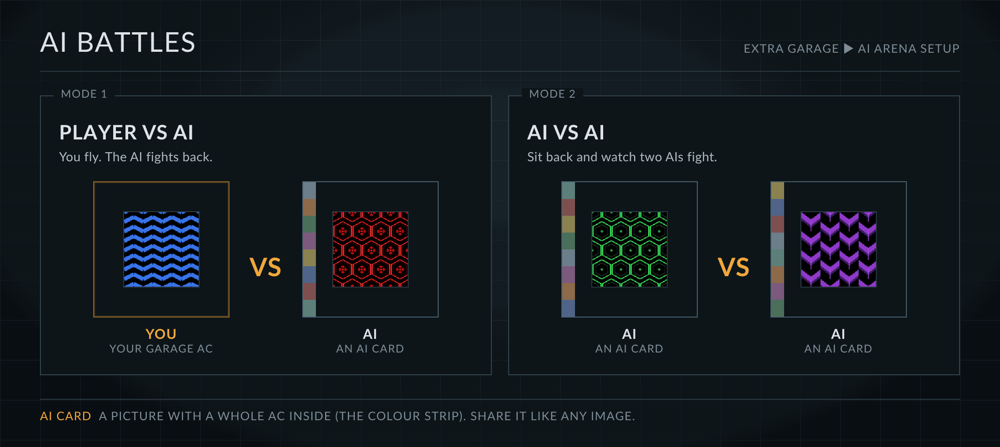

**Fight an AI, or watch two AIs fight.** *(In development: expect rough edges.)*

**How to play:** Launcher → **Extra Garage** → **AI Arena Setup**.

- **Player vs AI:** you fly against an AI.
- **AI vs AI:** sit back and watch.
- Pick a map and a time limit. The fight starts straight away.

<b>About AI cards</b> (click to open)

Each AI pilot is an **AI card**: a square picture, like an emblem, with the
whole AC stored in a colour strip down its left edge (parts, optional parts,
colours, Human Plus, emblem and AI). Share them like any picture.

- **Make cards** in **Extra Garage** (export your AC or a save), or in your
  web browser with the
  **[Raven Card Builder](https://hatdagger.github.io/ACMOA-AI-CARDBUILDER/)**.
- **Use cards:** put them in the **Memory Card** folder and they show up in
  the garage.
- In *Player vs AI* you fly the garage AC or an AI card's AC. Time limit:
  2:00, 5:00 or none.

---

## Extra Garage

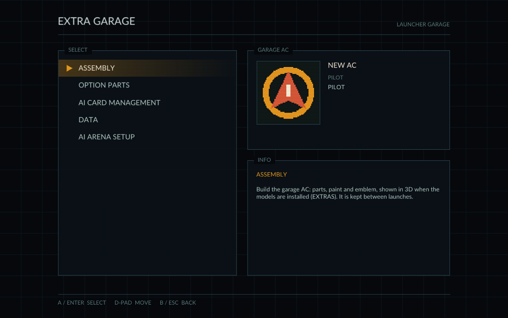

**A garage outside the game.** Build an AC in 3D, then use it everywhere.

**How to use:** Launcher → **Extra Garage**. (Run *Extras → Install 3D AC
models* once to see your AC in 3D.)

- **Build:** parts, option parts, paint, emblem and names.
- **Save:** to your memory card, or as an AI card.
- **Manage:** your memory card saves and AI cards.

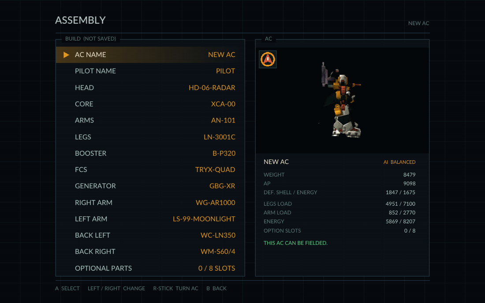

<b>Every screen</b> (click to open)

- **Assembly:** the game's Assembly screen with your AC in 3D. **Triangle /
  Y** shows a part's numbers; **Square / X** marks parts to compare (green
  better, red worse). It follows the game's own build rules.
- **Optional Parts:** fit option parts, switch **Human Plus** on or off.
- **Performance:** the game's breakdown of how your AC does.
- **Design:** paint, emblem, AC name and pilot name.
- **AI Programming:** the AI that goes with the AC when you export it as an
  AI card.
- **Memory Card:** load an AC from a save or an AI card, save the AC to the
  card (a new save, or into one of yours with any missing parts added),
  export saves as AI cards, delete saves. **L1 / R1** switch between memory
  card files. Every change keeps a backup (`.bak`).
- **AI Card Management:** edit, rename or delete your AI cards.
- **AI Arena Setup:** Player vs AI or AI vs AI.

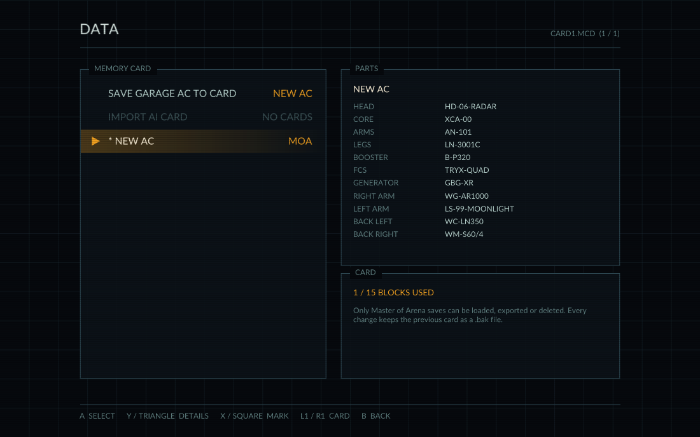

---

## The launcher

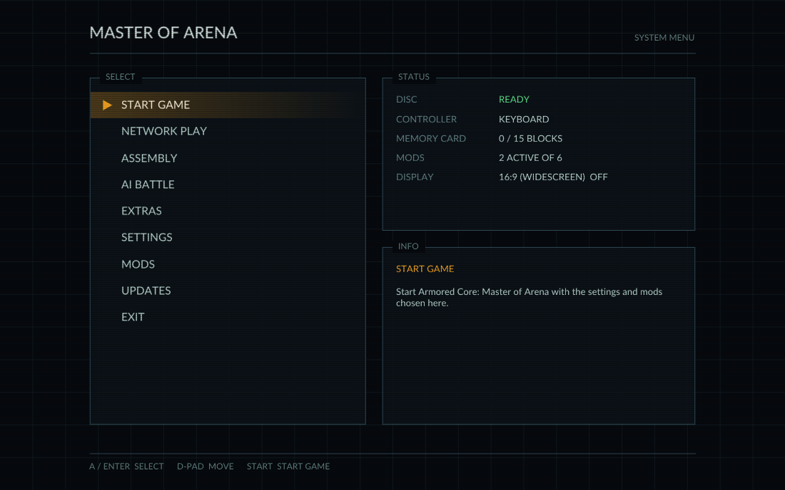

**Made for a controller.** Steam Deck and handheld PCs included. No mouse
needed. The keyboard always works too.

- **Start Game → Load Game:** pick your save and go straight to the hub.
- **Start Game → New Game:** straight to the name entry.
- **Start Game → Launch Game:** the title screen (switch **FULL BOOT** on to
  see the logos and intro).

<b>Everything else in the launcher</b> (click to open)

- **Rogue Arena**, **Multiplayer**, **Extra Garage:** see above.
- **Extras:** builds the Project Phantasma content and the 3D AC models from
  your own discs.
- **Settings:** display, sound and controls. A fresh install starts at 4:3,
  borderless fullscreen, 1440p, sharp pixels and vsync on.
- **Mods:** switch features on and off, or install new ones:
  - **Fast loading** (on): the first load is much faster.
  - **Demo movie first** (on): the title screen plays the demo movie first.
  - **Single disc play** (off): skips the game's leftover disc-swap prompt.
  - **In-between frames** (off, test): smoother camera in split-screen VS.
    Needs the OpenGL renderer.
- **Updates:** checks for a new version, only when you ask.
- Names are typed with an on-screen keyboard, or picked at random.

---

## Credits and licenses

- **Armored Core: Master of Arena** and **Project Phantasma** are ©
  FromSoftware. This is an unofficial fan project, not affiliated with
  FromSoftware, Agetec or Sony, and no game data is included.
- **[AC1Recomp](https://github.com/NeonLightning/AC1Recomp)** by NeonLightning:
  the Armored Core recompilation this fork started from.
- **[PSXRecomp](https://github.com/mstan/psxrecomp)** and
  **[recomp-ui](https://github.com/mstan/recomp-ui)** by mstan and
  [RetroPortingToolkit](https://retroportingtoolkit.com/): the PS1
  recompilation framework and the launcher it's built on.
- **[OpenBIOS](https://github.com/grumpycoders/pcsx-redux)** by the PCSX-Redux
  authors: the free PS1 BIOS that ships with the game, so you don't need a
  Sony BIOS.
- Plus SDL, Dear ImGui and other open-source libraries and fonts: see
  **[CREDITS.md](CREDITS.md)** for the full list with each license.

**License in short:** this project's own code ([LICENSE](LICENSE)) and the
framework (`psxrecomp/`) are both under the
[PolyForm Noncommercial 1.0.0](https://polyformproject.org/licenses/noncommercial/1.0.0)
license. You're free to use, share and change this build for
**noncommercial** purposes, but not to sell it. The launcher UI
(`recomp-ui/`) is [MIT](recomp-ui/LICENSE). Every release includes all the
license notices in its `licenses` folder.

**Something wrong?** Open an
[issue](https://github.com/Hatdagger/AC1Recomp/issues). Say what you did,
what you saw, and whether you're on Windows or Linux / Steam Deck.
