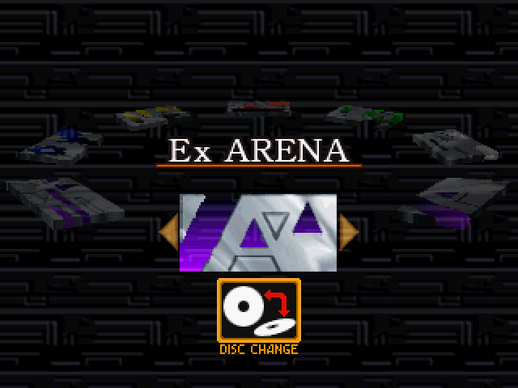
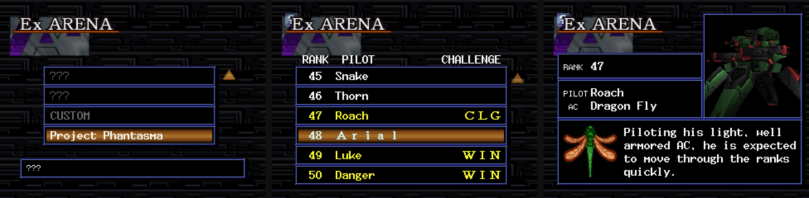
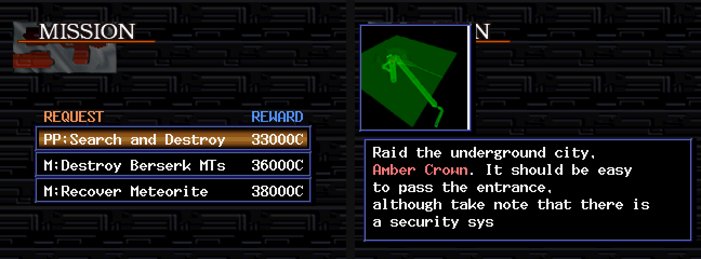
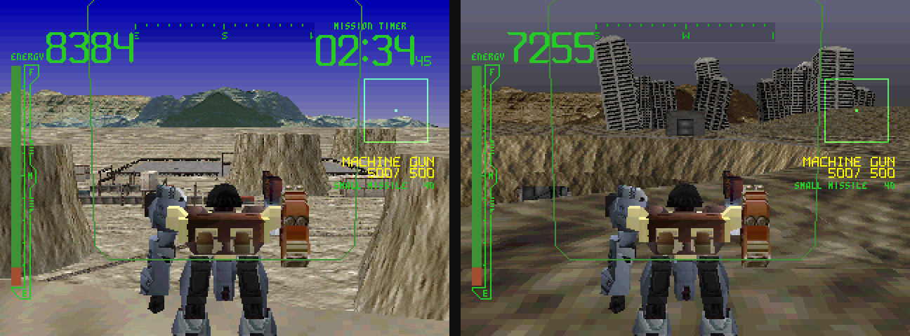

# Armored Core: Master of Arena — PC (unofficial build)

A native PC version of **Armored Core: Master of Arena** (PS1), with a
controller-first launcher, online/LAN versus, an AI battle mode and content
from **Armored Core: Project Phantasma** added into the game.

Built on the **[AC1Recomp](https://github.com/NeonLightning/AC1Recomp)**
static recompilation by NeonLightning. This fork focuses on Master of Arena
only.

**No game data is included.** You need your own copy of the game.

**[Download the latest release](https://github.com/Hatdagger/AC1Recomp/releases)**
(Windows `.zip`, Linux / Steam Deck `.AppImage`)

---

## 1. Put your disc next to the game

- **Required:** *Armored Core: Master of Arena* (USA) **Disc 1** as `.cue` + `.bin`.
- Put the disc image in the **same folder** as `Armored Core Moa.exe` (or the
  AppImage). It is found automatically, so there's nothing to select.
- **Optional:** *Armored Core: Project Phantasma* (USA), in the same folder,
  adds the Phantasma arena and missions (see below).

### One disc for everything

You only need Disc 1. Everything that normally needs Disc 2 (Ex Arena,
Ranker MK and so on) plays straight from Disc 1, with no disc swapping.

The game still shows its old **DISC CHANGE** icon and may still say
*"Insert DISC 2"*. **Ignore it:** press X and carry on. All the content is
there.

---

## 2. Launcher

<!-- Launcher screenshot goes here: docs/readme/launcher.png -->

A launcher in Master of Arena's own style, made for a **gamepad**
(Steam Deck and handheld PCs included). No mouse needed.

- **Start:** launch the game.
- **Network:** two-player versus over **LAN or online**.
  - One player hosts a lobby, the other joins (recent hosts are remembered, and
    an IP address is entered digit by digit with the d-pad).
  - **Names are picked for you** from the game's arena pilot names, so
    there's nothing to type.
  - Each player plays on their own screen, with their own AC and memory card.
- **AI Battle:** pick two AC "cards" and watch the computer fly both (see below).
- **Mods:** switch features on and off, or install new ones.
- **Extras:** *Install data from Project Phantasma* builds the Phantasma
  content on your PC from your own disc (it finds the disc by itself).
  *Reinstall additional content* removes it and builds it again.
- **Updates:** checks GitHub for a new release and installs it, only when you
  ask.

---

## 3. AI Battle (computer vs computer)

Pick two ACs and watch the computer fly both, using the game's own arena AI.

- **Where:** Launcher → **AI Battle**. Choose **Unit 1**, **Unit 2** and the
  stage, then start the battle.
- **The ACs are "cards":** each one is a square picture, like an AC emblem,
  with the whole build (parts, optional parts, colours, Human PLUS, emblem)
  stored in a colour strip down its left edge. They're easy to share as
  ordinary images.
- **Make cards** with the
  **[Raven Card Builder](https://github.com/Hatdagger/ACMOA-AI-CARDBUILDER)**,
  a page that runs in any web browser. Pick parts from sorted lists, check the
  stats and the game's own build rules, and turn any picture into the emblem.
- **Or export your own ACs:** the launcher can turn the ACs in your memory card
  saves into cards.
- Put cards in the **Memory Card** folder and they show up in AI Battle.
- **How a card fights:** it borrows the AI of an arena opponent that uses the
  same legs (matching arms or head make that pilot more likely), so the same
  card always fights the same way.

---

## 4. Project Phantasma arena

- **How to get it:** Launcher → **Extras** → *Install data from Project
  Phantasma*. If you installed it with a version before 0.4.1, use
  *Reinstall additional content* to get the missions too.
- **Where it is:** in game, **Ex Arena** → **Project Phantasma** (the tenth
  entry).
- **What came over:** all **49 arena ACs from Project Phantasma**, with their
  pilots, AC names, emblems, portraits and profiles.
- It has its own ranking: you start at the bottom (rank 50) and climb.
  Prize money is scaled to Master of Arena's economy.

---

## 5. Project Phantasma missions (work in progress)

**The goal:** play all 17 Project Phantasma missions inside Master of Arena,
with their own briefings, maps and enemies, and with any AC you build.

**Where it is today (0.4.1):**

- Installed together with the arena (same Extras button).
- The next Phantasma mission sits at the top of the **Mission** list as
  **"PP: …"**. Master of Arena's own missions show **"M: …"**.
- Missions unlock **one at a time**, in order.
- **12 of 17 missions are in.** Missions 1, 7, 9, 11 and 14 are left out for
  now because they freeze or don't display correctly.
- No replay list yet. Once you've finished them, the Phantasma missions leave
  the list.
- Progress is saved in `Phantasma Missions.txt` in the **Memory Card** folder,
  one progress per memory card (every save on the card shares it).
- A few long mission names are shortened to fit the list.

**Planned:** a separate Phantasma mission list (like Arena's two lists), the
missing missions, and replays after the last mission.

---

## Folders (Windows release)

| Folder / file | What it is |
|---|---|
| `Armored Core Moa.exe` | Start here |
| your `.cue` + `.bin` | Your Master of Arena Disc 1 (and optionally Project Phantasma) |
| `Memory Card/` | Memory cards, AI Battle cards (`.png`) and Phantasma mission progress |
| `Mods/` | Mods |
| `RecompData/` | Everything else the game needs |

---

## Credits

- **[AC1Recomp](https://github.com/NeonLightning/AC1Recomp)** by NeonLightning,
  the recompilation this build is based on.
- Armored Core is © FromSoftware. This is an unofficial fan project, with no
  game data included and not affiliated with FromSoftware or Agetec.

Problems or feedback: please open an
[issue](https://github.com/Hatdagger/AC1Recomp/issues) and say what you did,
what you saw, and whether you're on Windows or Linux / Steam Deck.
