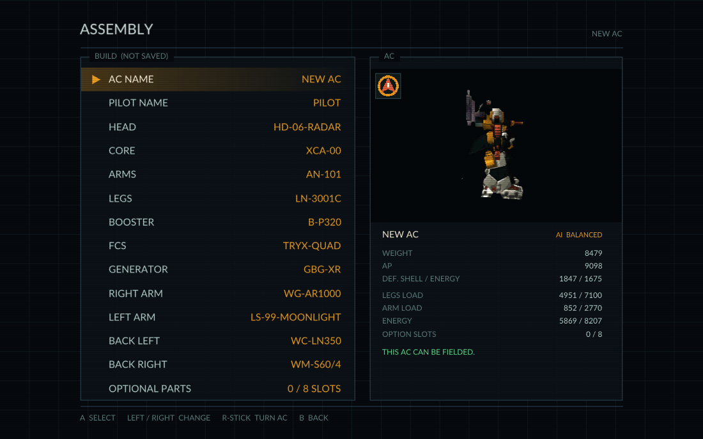
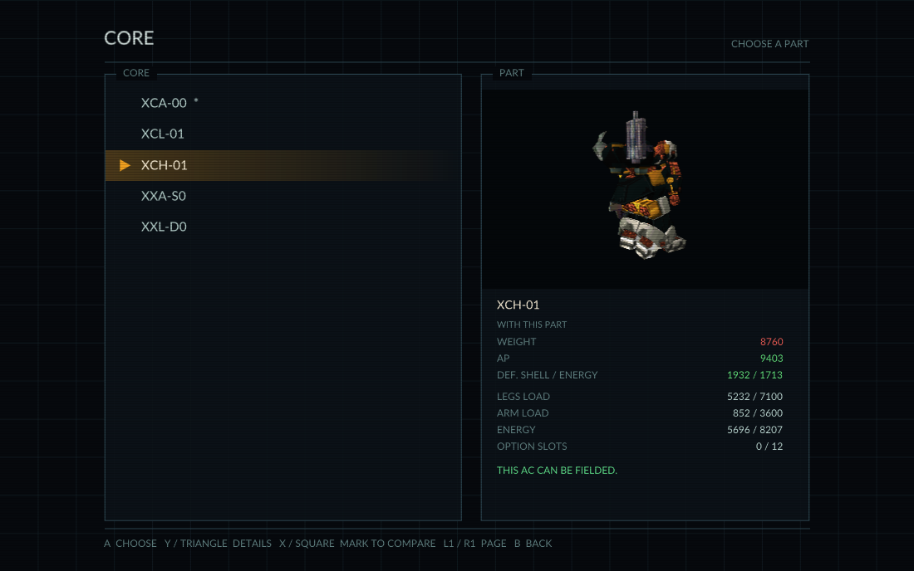
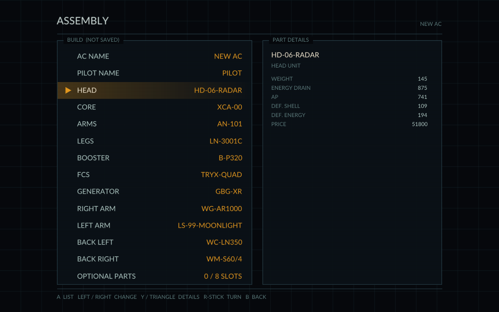
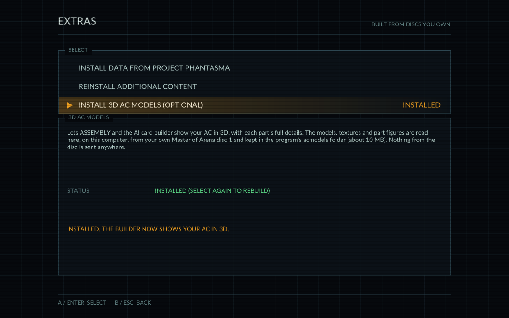

An unofficial build of the Armored Core: Master of Arena recompilation (based on
[NeonLightning/AC1Recomp](https://github.com/NeonLightning/AC1Recomp)), with a
controller-first launcher and new modes. **No game data is included: you need
your own copy of Armored Core: Master of Arena (USA).**

This is a test release. Please report problems in this repository's Issues
(what you did, what you saw, Windows or Linux/Steam Deck).

## What's new in 0.8.3

- **Updater:** mods that ship with a new release (in Mods/bundled) are now
  installed when you update from the launcher. Your own mods are still left
  alone.
- **Demo movie first:** the title screen now plays the demo movie before the
  opening movie (the loop still alternates). Toggle "Demo movie first" on the
  launcher's MODS page; off restores the original order.
- **AI Battle time limit:** the countdown now starts at the time you pick
  (2:00 showed about 2:45 before; the arena engine counts 22 steps a second,
  not 30).
- **Mission picker:** MISSIONS now opens a short list first: Armored Core
  (not installed yet), Project Phantasma and Master of Arena. Pick one to see
  its missions; back out to return to the picker. The "PP:" and "M:" name
  prefixes are gone. While Phantasma missions are being tested, its list shows
  all of them except the ones that still hang (1, 7, 9, 11 and 14).
- **Public address in the Versus Room:** when you host a LAN room, the ROOM
  panel now shows your public IP address and port under the LAN address, so
  friends outside your network know what to join (the UDP port has to be
  forwarded to your PC).
- **Assembly (preview):** a new ASSEMBLY screen on the launcher's main menu
  builds an AC and shows it in 3D. Install the models once from EXTRAS:
  "INSTALL 3D AC MODELS (OPTIONAL)" (read from your own disc, about 20 MB).
  Turn the AC with the right stick, see each part's figures with Triangle,
  mark up to three parts with Square to compare them (green better, red
  worse), and save the AC to your memory card as a new save (it never
  overwrites one; a new card is made if you don't have one yet). Load it in
  game from VS mode: AC SETUP > SYSTEM > DATA LOAD.

  
  
  
  
- **Phantasma missions no longer advance Master of Arena's story:** finishing
  one used to move MoA's chapter forward, unlocking MoA missions and mail
  early. Now only Phantasma's own progress changes.
